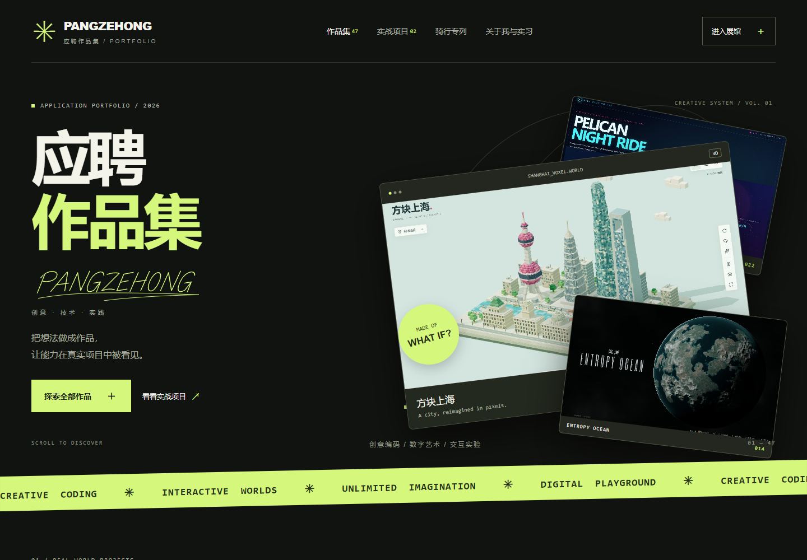

# PANGZEHONG · 工作投递书与个人作品集

用可以体验的作品，介绍我如何把想法做成产品。

**求职方向：AI 应用开发 / 前端交互开发 / 自动化工作流相关岗位**  
**联系邮箱：[15322523080@163.com](mailto:15322523080@163.com)**  
**GitHub：[PZEHONG](https://github.com/PZEHONG)**

**在线作品集：[https://pzehong.github.io/pangzehong-portfolio/](https://pzehong.github.io/pangzehong-portfolio/)**



## 工作投递书

您好，招聘负责人：

我是 PANGZEHONG，希望应聘 AI 应用开发、前端交互开发或自动化工作流相关岗位。这份仓库是我的应聘作品集，集中展示实战项目、AI 辅助创作与实习记录，也提供可以在本地运行的页面和源码，方便您直接了解项目的交互和实现。

我关注如何把实际需求转化为可以使用的工具。在实战项目中，AI 智能实习工作台将签到记录、实习周报与月报集中管理；Token 代理中心围绕 AI 服务接入与调用展开。作品集为这两个项目提供功能介绍、页面截图和访问入口，便于结合实际界面交流需求与实现思路。

实习期间，我搭建了 TikTok 自动化工作流，并通过带货后台的 GMV、成交件数与商品曝光记录业务表现。作品集中整理了 13 张后台实拍及对应的数据说明：2026 年 6 月、7 月 Commission GMV 的展示值分别约为 $4.8K、$2.8K，合计售出 412 件；8 月完整月报单独展示归因 GMV 约 $1.7K、成交 134 件。这些是对应后台报表的业务记录，不等同于个人收入，也不将不同账号、单日快照和阶段数据重复累加。

在创意实践方面，我使用 AI 辅助探索网页、动画与交互，并把作品整理为便于浏览的展示站。当前作品集包含 48 件作品，覆盖三维场景、互动游戏、视觉实验和动画。首页实现了分类筛选、按需加载的悬停演示、提示词查看与复制、移动端适配，以及键盘操作和减少动态效果支持。作品来源在数据及下方说明中保留；合集数量不作为全部作品均独立原创的声明。

我希望在团队中参与需求拆解、界面与交互实现、AI 工具应用、自动化流程搭建及验证迭代。面试时，我愿意结合具体项目展示运行效果、说明 AI 辅助过程与人工调整内容，并交流实现中的取舍和后续改进方向。

感谢您查看这份投递材料。如果岗位需要能够把创意、工具与实际业务连接起来的人，欢迎通过 **[15322523080@163.com](mailto:15322523080@163.com)** 与我联系。

PANGZEHONG

## 先看这些项目

| 项目 | 展示重点 | 入口 |
| --- | --- | --- |
| AI 智能实习工作台 | 签到记录、实习周报与月报管理 | [在线访问](https://xqd.aist.ink/#/records) · [社区版源码](https://github.com/PZEHONG/xunqiandao-community) |
| Token 代理中心 | AI 服务接入与调用管理；作品集附界面截图 | [在线访问](https://qine.aist.ink/index.html) |
| TikTok 自动化工作流 | 自动化实践、后台报表与实习成果整理 | [项目入口](http://qingkongai.com/) · [数据说明](assets/internship-data.json) |
| 喵喵钢琴 | 浏览器音乐交互与猫咪音效 | [本仓库页面](works/cat-piano/index.html) · [独立仓库](https://github.com/PZEHONG/cat-piano) |
| 收山录 | 三维地球与山野档案交互 | [本仓库页面](works/shoushanlu/index.html) · [独立仓库](https://github.com/PZEHONG/shoushanlu) |
| DeepSeek Harness 开屏动画 | 4 秒 4K 动画与独立播放器展示 | [本仓库页面](works/deepseek-splash/index.html) · [独立仓库](https://github.com/PZEHONG/deepseek-splash) |

GitHub 中的 HTML 链接用于阅读源码；实际交互可通过 [在线作品集](https://pzehong.github.io/pangzehong-portfolio/) 体验，也可下载仓库后本地运行。外部实战项目可能需要登录，本仓库不包含其服务端、账号或访问凭据。截图中的性能数据仅代表对应测试场景，不构成通用性能承诺。

## 公网访问与部署

本作品集通过 GitHub Pages 发布，桌面和手机均可直接访问，无需安装环境：

**[打开在线作品集](https://pzehong.github.io/pangzehong-portfolio/)**

发布来源为 `main` 分支根目录，后续推送更新后由 GitHub Pages 自动重新部署。根目录 `.nojekyll` 用于保持静态文件原样发布。站点包含首页、48 件作品及其本地图片、音频和视频资源；两个外部实战项目通过原有地址访问。

## 本地运行

安装 Node.js 后执行：

```sh
git clone https://github.com/PZEHONG/pangzehong-portfolio.git
cd pangzehong-portfolio
npm start
```

浏览器打开 **http://localhost:4173/**。运行站点不需要安装第三方依赖。Windows 用户也可以双击 `启动预览.cmd`。

首页可直接打开 `index.html`；涉及 JavaScript 模块的作品请通过本地服务访问。部分原作品使用外部资源，需要网络连接。

## 项目结构与技术

站点使用 HTML、CSS 和原生 JavaScript，运行与维护工具使用 Node.js，浏览器验证使用 Playwright。不同作品按自身需要使用 Three.js、Canvas、SVG 等技术。

| 路径 | 内容 |
| --- | --- |
| `index.html` | 作品集首页、实战项目与实习经历 |
| `assets/` | 页面样式、筛选与预览逻辑、作品与实习数据 |
| `works/` | 48 件作品的本地展示页面和资源 |
| `previews/` | 作品封面、页面截图与实习展示图片 |
| `scripts/` | 本地服务、截图、备份整理与验证工具 |
| `backup/` | 原站归档、来源清单与完整性验证记录 |
| `docs/MAINTENANCE.md` | 维护、数据口径与归档范围说明 |

## 验证与维护

保持本地服务运行，在另一个终端执行：

```sh
npm ci
npm test
```

现有验证脚本使用 Windows 默认位置安装的 Chrome（`C:/Program Files/Google/Chrome/Application/chrome.exe`）。其他系统需调整脚本中的浏览器启动配置。检查覆盖作品与资源完整性、分类筛选、提示词复制、实习图库、键盘焦点、响应式布局及合集页面。

悬停预览检查可执行 `node scripts/verify-previews.mjs`。详细维护流程见 [维护说明](docs/MAINTENANCE.md)。

## 来源与开源许可

作品集以原站公开客户端文件为基础整理：原始 45 件作品来自 [原站作品目录](http://shop.website88.net/gpt6-works/index.html)，归档日期为 2026-10-09；另整合了喵喵钢琴、收山录和 DeepSeek 开屏动画，共 48 件。原始来源、路径和哈希记录见 `backup/manifest.json`，作品级来源见 `assets/works.json`。

本仓库新增且由维护者拥有权利的代码采用 [MIT License](LICENSE)。归档作品、引入项目、第三方依赖及图片、音频、视频等素材不因本仓库发布而变更许可，详见 [来源与许可范围](THIRD_PARTY_NOTICES.md)。

欢迎通过 Issue 提交问题或改进建议。招聘与合作请联系 **[15322523080@163.com](mailto:15322523080@163.com)**。
